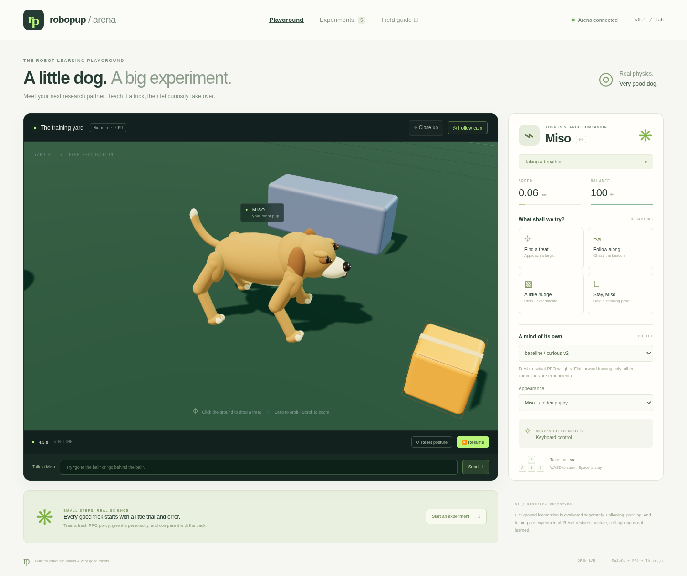
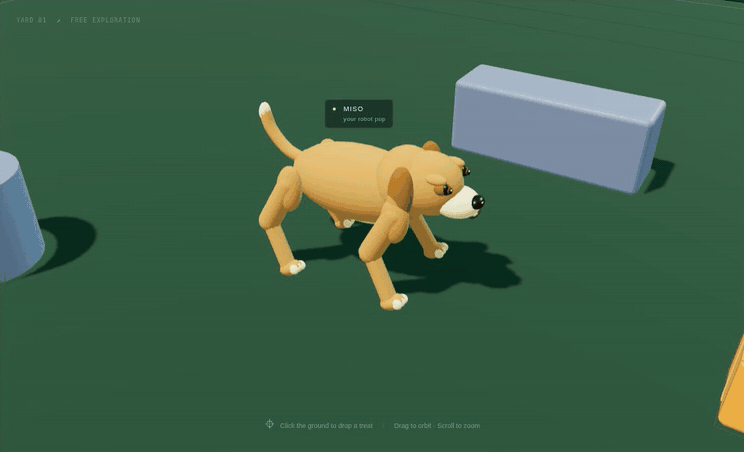

# RoboPup Arena

**A little dog. A big experiment.**

An interactive robot-pet lab: real MuJoCo contact physics, a playful Three.js yard,
fresh PPO policies, and inspectable experiment results. Inspired by
[robo-jev](https://github.com/STEERIX-home/robo-jev)'s separation of physical judgment
and motor control. This repository's decision layer currently uses rules.



**Prototype, not a hardware controller.** The local arena runs on CPU; optional
MJX physics runs on GPU. PPO learns joint-target residuals around an analytic trot,
starting with fresh network weights. No pretrained weights are required for training.

An RTX 5090 experiment completed **1,048,576 steps in 121.7 seconds**, then averaged
**0.337 m/s with no falls in five 12-second native-CPU trials**. Both CPU and
GPU-trained demo checkpoints are included. See the [raw benchmark evidence](docs/BENCHMARKS.md)
for compilation/setup time, a failed attempt, costs, and limits. Following,
pushing-to-goal, learned recovery, and Jev integration remain incomplete.



Actual browser capture of the bundled GPU-trained checkpoint, cropped and looped.
[Full six-second recording](docs/assets/puppy-walk.webm). The new puppy capture
averaged about 5 frames/s using software WebGL; hardware-browser FPS is unmeasured.
The puppy is original, stylized procedural artwork, not a photoreal canine asset.

## Start the yard

Requires Linux, Python 3.11–3.13, Node 20.19+ or 22.12+, and `uv`.

```bash
bash scripts/setup.sh
bash scripts/start.sh
```

The server listens on port 8000 on the local machine. Access it with a private
port-forward from your development environment. Do not expose this unauthenticated
research server directly to the public Internet. Each browser tab receives an
independent simulated world. Use one Uvicorn worker.

The browser demo needs no GPU. For a manual local setup (including PowerShell),
run `uv sync --frozen --extra dev`, then `uv run python scripts/seed_demo.py` from
the root. Run `npm ci --ignore-scripts` and `npm run build`
inside `web/`, then `uv run uvicorn robopup.server:app --host 127.0.0.1 --port 8000`
from the repository root. Set writable cache directories if your host restricts
them. Linux is tested here; Windows and Apple Silicon installation are not yet
validated. PyTorch 2.9 does not support every older CPU/OS combination.

- Click the ground to drop a treat; select **Find a treat**.
- Drag to orbit, scroll to zoom, or enable **Follow cam**. **Close-up** frames Miso
  and follows along so you can inspect the gait.
- **WASD** steers; **Space** requests a standing pose.
- **Pause** freezes physics; **Reset posture** resets the world, including the crate.
- Select a locally trained policy to compare it with the analytic gait.
- Switch **Appearance** between the golden puppy and the original research robot.
  Both display the same physics and policy; this does not retrain or replace the gait.
- Talk to Miso: **go to the ball**, **go behind the ball**, **follow me**, **push the crate**, **stop**.
  This is a local command grammar. Ball missions report completion from physics
  contacts or measured position; free-form language understanding is not implemented.
- Select **baseline / curious-v2** for the validated ball-boop demo. The GPU-trained
  policy is validated for flat-ground locomotion and can fail the contact task.
- **Experiments** reads actual run results; the UI does not start training or cloud resources.

The physical robot and crate transforms come from MuJoCo. Decorative eyes, ears,
tail, treat beacon, grid and painted boundary line are visual only. Tail wagging
and blinking freeze with Pause. The renderer buffers snapshots by 60 ms and
interpolates physical poses; it never invents extra locomotion. Obstacles and the crate
collide physically. The ball has rolling friction and the yard has low physical
boundary walls. The crate and ball are moved only by contact, never scripted forces.
The puppy's rounded coat, muzzle, floppy ears, paws and collar are a visual skin
attached to 18 physical geometries. Its silhouette is an approximation of the
collision robot. All leg poses still come from MuJoCo. The skin uses 18,248
triangles and a shared, generated 256×256 fur-bump texture, with no external asset
downloads. This is a rendering upgrade, not an anatomically validated dog rig.

## Which model is running?

The trained motor policy is a **15,705-parameter MLP**, not a transformer. Its
deterministic actor has 8,204 parameters; the checkpoint archive also contains
the critic and training state. Bundled files are **219 KiB** (CPU curious-v2) and
**254 KiB** (RTX 5090). Weights are in this repository's `demo/` directories,
copied into local `artifacts/` by setup. Nothing is hosted on Hugging Face.

The live controller takes numerical proprioception, uses rule-based task
decisions, and parses a small text-command grammar. It does not consume images
or voice. The RTX 5090 accelerated MJX physics; the small PPO optimizer ran on CPU.
See the [model card and exact weight inventory](docs/MODEL_CARD.md).

A separate **769,149-parameter multimodal transformer scaffold** now accepts
image history, text tokens and numeric state and emits six proposed skill slots.
It is **untrained and disconnected from the live arena**. Its tensor/gradient
tests do not establish perception, instruction understanding, or planning ability.
The [vision, voice, energy and skill roadmap](docs/MULTIMODAL.md) explains how to
build that next layer, including what walk/run/jump and physical fetch require.

## Train your first policy

```bash
uv run robopup-train --participant alice --run first-trick --config configs/curious.json
uv run robopup-evaluate --model artifacts/alice/first-trick/policy.zip --out artifacts/alice/first-trick/recheck.json
uv run python -m robopup.tasks --model artifacts/alice/first-trick/policy.zip --out artifacts/alice/first-trick/tasks.json
```

Choose `curious`, `gentle`, or `zoomies`; customize a copied JSON config to change
speed, seed, or energy penalty. A participant/run directory is created exclusively:
reusing an ID fails rather than overwriting a previous experiment. Outputs include
configuration, source hashes, metadata, episode logs, PPO progress CSV, intermediate
checkpoints, final weights, training time, and five-seed evaluation JSON.

Training defaults to CPU. A small MLP and CPU physics do not automatically benefit
from a GPU. Run the benchmark before renting compute. No script in this repository
creates paid infrastructure.

## Evidence and workshop

- [Actual benchmark results](docs/BENCHMARKS.md), including the failed first run.
- [Validation record and passing CI](docs/VALIDATION.md).
- [Changelog](CHANGELOG.md).
- [Feature status and limitations](docs/STATUS.md).
- [Two-hour workshop for 5–10 participants](docs/WORKSHOP.md).
- [Runpod setup, key handling, and approval plan](docs/RUNPOD.md).
- [Architecture and research path](docs/ARCHITECTURE.md).
- [Model sizes, weight locations, and current inputs](docs/MODEL_CARD.md).
- [Multimodal transformer and skill roadmap](docs/MULTIMODAL.md).
- [Upstream license audit](docs/UPSTREAM_AUDIT.md).

```bash
uv run pytest -q
uv run ruff check src tests scripts
uv run robopup-benchmark --out artifacts/physics-benchmark.json
cd web
npm ci --ignore-scripts
npm run build
npm test
```

Browser tests need Chromium. Set `CHROMIUM_PATH` to its executable if it is not at
`/usr/bin/chromium`. They run a real local server and verify actual physics state,
controls, policy loading, mobile layout, and simultaneous independent sessions.

## Development

Use the existing checkout in each isolated cloud task; no Git worktree is needed.
`bash scripts/setup.sh` installs the frozen Python/npm dependencies, builds the
browser, verifies the pinned Runpod CLI checksum, and runs the Python tests.
For frontend development, run the backend and `cd web && npm run dev` separately.
Vite proxies API and WebSocket traffic to the backend on port 8000.

Before publishing changes, run `uv run python scripts/check_public_secrets.py --history`.
It checks tracked files and reachable history for common Runpod/GitHub token and
private-key patterns without printing values. CI repeats the tracked-file check.
This targeted check does not detect every possible secret. Keep real credentials
in secure environment bindings; `.env` files and local artifacts are ignored.

To record the actual trained walker, start the arena, then run
`node web/scripts/record-demo.mjs` from the root. Chromium and system FFmpeg are
required. It saves a video, screenshot, and timing/position measurements under a
new `artifacts/presentation/` directory. Recording starts no training or cloud jobs.

Original code and primitive geometry: [MIT](LICENSE). Dependencies retain their
own licenses; see [third-party notices](THIRD_PARTY_NOTICES.md). The project is
named RoboPup Arena; its connected GitHub repository is
`sanjuhs/robo-pup-decision-model`.
