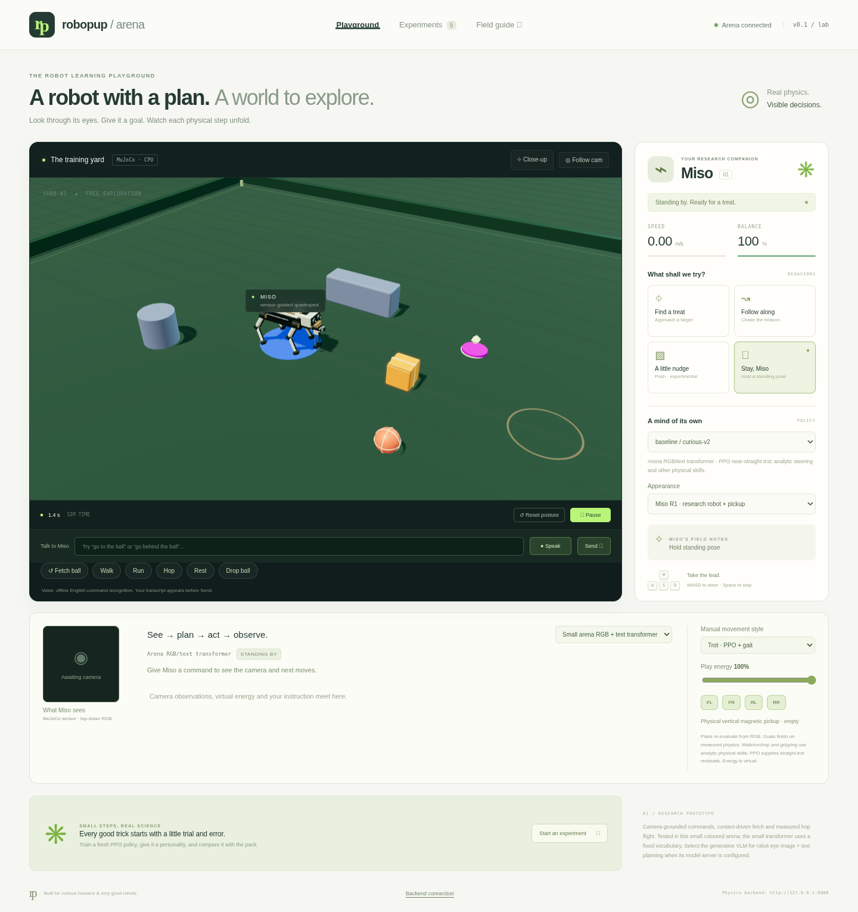

# RoboPup Arena

**A robot with a plan. A world to explore.**

An interactive robot-pet lab: real MuJoCo contact physics, a playful Three.js yard,
fresh PPO policies, and inspectable experiment results. Inspired by
[robo-jev](https://github.com/STEERIX-home/robo-jev)'s separation of physical judgment
and motor control. Miso now has a trained camera/text/state transformer,
physical skills, a visible six-row plan, and an optional genuine Qwen vision-language
model for sequential missions from its onboard camera.



[Watch a complete, unsped browser fetch](docs/assets/gpu-planner-fetch.webm):
actual contact, lift, return and release, with the camera and plan panel visible.
[Recording evidence](benchmarks/gpu-planner-v4/browser-recording.json).

**Prototype, not a hardware controller.** The local arena runs on CPU; optional
MJX physics runs on GPU. PPO learns joint-target residuals around an analytic trot,
starting with fresh network weights. No pretrained weights are required for training.

An RTX 5090 experiment completed **1,048,576 steps in 121.7 seconds**, then averaged
**0.337 m/s with no falls in five 12-second native-CPU trials**. Both CPU and
GPU-trained demo checkpoints are included. See the [raw benchmark evidence](docs/BENCHMARKS.md)
for compilation/setup time, a failed attempt, costs, and limits. The current
v4 multimodal controller passed **24/24 fresh varied-start trials** across
approach, behind, fetch, push, follow, walk, run and hop. These are small arena tests; general
vision/language, learned recovery and Jev integration remain incomplete.


Actual browser capture of the bundled GPU-trained checkpoint, cropped and looped.
[Full six-second recording](docs/assets/puppy-walk.webm). The new puppy capture
averaged about 5 frames/s using software WebGL; hardware-browser FPS is unmeasured.
The puppy is original, stylized procedural artwork, not a photoreal canine asset.

## Understand the system

[Start with the illustrated explanation](docs/EXPLAINER.md): what we trained,
where PPO fits, how commands become physical behavior, and participant setup.

The large vision-language model and the small arena controller are separate.
**Qwen3-VL-2B-Instruct** is the pretrained, generative VLM: actual robot-eye RGB,
English instructions, virtual energy, held state and verified action history go
in; a validated sequence of skills comes out. The native mission runtime executes
one step, checks the physical outcome, captures fresh eyes and asks for the
remaining plan. The existing v4 controller still grounds low-level targets from
its overhead RGB camera. This is a hierarchy, not an end-to-end learned robot policy.

| Your question | Read this |
| --- | --- |
| What do motor control, arena skills and Qwen each decide? | [Concrete task examples, data and step-by-step flow](docs/TASK_FLOW.md) |
| What is closest to RoboJev, and what differs? | [Source-audited RoboJev comparison](docs/ROBOJEV_COMPARISON.md) |
| How do robot eyes become sequential decisions? | [VLM architecture and decision flow](docs/VLM_GUIDE.md) |
| Which weights, sizes and licenses are used? | [Model card](docs/MODEL_CARD.md) and [VLM model guide](docs/VLM_GUIDE.md#where-the-weights-live-and-how-large-they-are) |
| What did we actually train? | [PPO training](docs/ARCHITECTURE.md), [v4 training history](docs/MULTIMODAL.md), [GPU experiment](docs/GPU_PLANNER_EXPERIMENT.md) |
| How do I download the VLM or use the HF CLI? | [Hugging Face setup](docs/VLM_GUIDE.md#download-and-run-locally) |
| How do app, web and planner deploy? | [Vercel services and backend deployment](docs/DEPLOYMENT.md), [vercel.json](vercel.json) |
| What passed, failed or remains incomplete? | [Validation](docs/VALIDATION.md), [current status](docs/STATUS.md), [raw benchmarks](benchmarks/) |

Qwen's public checkpoint is **2,127,532,032 parameters**, Apache-2.0, pinned to
[`89644892e4d85e24eaac8bacfd4f463576704203`](https://huggingface.co/Qwen/Qwen3-VL-2B-Instruct/tree/89644892e4d85e24eaac8bacfd4f463576704203).
We integrate its pretrained weights; we have not pretrained or fine-tuned this
foundation model. The public download needs **no Hugging Face token**. Its weights
live in ignored `artifacts/vlm/`, separate from the approximately 1 MB v4 weights
committed in `demo/`. No Hugging Face Space has been published.
[.env.example](.env.example) lists variable names with blank credentials; never
push real token values.

The actual Qwen loop completed **fetch → hop → stop** in **23.45 wall seconds on
Runpod** and **183.27 seconds on CPU**, with three fresh-eye model calls in each
trial. These headless trials paused physics while thinking. The RTX 4090 allocation
cost an estimated **$0.083** and was deleted; cumulative recorded GPU estimate is
**$0.79**, with invoices/storage unreconciled. [Raw GPU mission and cleanup](benchmarks/vlm-2026-10-16/gpu-4090/).

**Known vision failure:** the unguarded VLM produced the same look/fetch/stop plan
for real, blank and turned-away images. Valid JSON and a successful canonical
mission do not establish reliable visual reasoning. The linked records retain
these failures; contract/transport fixtures are labeled separately.

An explicit **eye visibility guard** now checks fresh RGB before each action. It
reuses 821 unchanged trained pixel-classifier parameters and refuses fetch/push/
follow when their target lacks confident visual evidence. Blank and turned-away
views are rejected. This is limited to the arena's colors; it does not make Qwen
a reliable visual reasoner. [Guard, masks and fresh-view probes](benchmarks/vlm-2026-10-16/eye-grounding/).

The guarded mission also **passed in the actual browser** with contact, lift,
return/release, hop and landing checked independently. It took **403.79 wall
seconds on CPU** while software WebGL recorded the arena; physics kept running
while Qwen thought. [Watch the full unsped run](benchmarks/vlm-2026-10-16/browser-guarded/actual-run.webm)
or inspect its [raw responses and physical checks](benchmarks/vlm-2026-10-16/browser-guarded/).
This is one canonical mission, with slow CPU inference rather than production
interactive latency. The earlier failed browser attempt remains published.

To move closer to RoboJev, keep three layers explicit: **Qwen plans the mission,
a judgment layer decides whether the next action is justified, and physical
controllers execute and verify it**. A learned, calibrated RoboJev-style judgment
model and fully eye-based low-level control remain research work. See the
[source-audited comparison and next experiments](docs/ROBOJEV_COMPARISON.md#how-to-move-closer-to-the-robojev-research-goal).

## Start the yard

Requires Linux, Python 3.11–3.13, Node 20.19+ or 22.12+, and `uv`.
Headless RGB rendering also needs EGL/Mesa (`libegl1 libgl1-mesa-dri` on Ubuntu).

```bash
bash scripts/setup.sh
bash scripts/start.sh
```

The server listens on port 8000 on the local machine. Access it with a private
port-forward from your development environment. Do not expose this unauthenticated
research server directly to the public Internet. Each browser tab receives an
independent simulated world. Use one Uvicorn worker.

The browser demo needs no GPU. For a manual local setup (including PowerShell),
run `uv sync --frozen --extra dev`, then `uv run python scripts/seed_demo.py` from
the root. Run `npm ci --ignore-scripts` and `npm run build`
inside `web/`, then `uv run uvicorn robopup.server:app --host 127.0.0.1 --port 8000`
from the repository root. Set writable cache directories if your host restricts
them. Linux is tested here; Windows and Apple Silicon installation are not yet
validated. PyTorch 2.9 does not support every older CPU/OS combination.

- Click the ground to drop a treat; select **Find a treat**.
- Drag to orbit, scroll to zoom, or enable **Follow cam**. **Close-up** frames Miso
  and follows along so you can inspect the gait.
- **WASD** steers; **Space** requests a standing pose.
- **Pause** freezes physics; **Reset posture** resets the world, including the crate.
- Select a locally trained policy to compare it with the analytic gait.
- Switch **Appearance** between the default research robot with physical pickup and the optional golden puppy.
  Both display the same physics and policy; this does not retrain or replace the gait.
- Try **fetch the ball**, **go behind the ball**, **push the crate**, **follow me**,
  **walk forward**, **run forward**, **jump**, **rest**, **drop the ball**, or **stop**.
  The default trained brain reads actual overhead RGB, English tokens and state.
  The camera/plan panel shows what it sees and proposes. Wording outside the
  bounded vocabulary can fail; the displayed confidence is uncalibrated.
- **Speak** records a short offline English command. Check the transcript, then
  press **Send**. Microphone access needs HTTPS or localhost.
- **Play-energy** is a virtual game variable: lower it to see rest/recharge.
- The default **baseline / curious-v2** motor supplies straight-trot residuals.
  Walk, run, hop, steering and magnetic retrieval use analytic physical skills.
  The GPU-trained policy remains selectable; its manipulation results differ.
- **Experiments** reads actual run results; the UI does not start training or cloud resources.

The physical robot and crate transforms come from MuJoCo. Decorative eyes, ears,
tail, treat beacon, grid and painted boundary line are visual only. Tail wagging
and blinking freeze with Pause. The renderer buffers snapshots by 60 ms and
interpolates physical poses; it never invents extra locomotion. Obstacles and the crate
collide physically. The ball has rolling friction and the yard has low physical
boundary walls. The crate moves by contact. The ball moves by contact and a contact-gated magnetic
lifting gripper during fetch; it is never teleported. The gripper is a simulated
tool, not a canine mouth. Hop uses joint motors and has measured flight/landing.
The puppy's rounded coat, muzzle, floppy ears, paws and collar are a visual skin
attached to 18 physical geometries. Its silhouette is an approximation of the
collision robot. All leg poses still come from MuJoCo. The skin uses 18,248
triangles and a shared, generated 256×256 fur-bump texture, with no external asset
downloads. This is a rendering upgrade, not an anatomically validated dog rig.

## Which model is running?

The trained motor policy is a **15,705-parameter MLP**, not a transformer. Its
deterministic actor has 8,204 parameters; the checkpoint archive also contains
the critic and training state. Bundled files are **219 KiB** (CPU curious-v2) and
**254 KiB** (RTX 5090). Weights are in this repository's `demo/` directories,
copied into local `artifacts/` by setup. These RoboPup-trained weights have not
been uploaded to Hugging Face; the optional Qwen foundation weights come from its
public Hugging Face repository.

The **trained arena planner is a separate 246,712-parameter transformer** with a
1,011,137-byte checkpoint at `demo/arena-planner/`. It consumes 96×96 MuJoCo RGB,
word tokens and 53 state values. It replans six skill/target slots every half
simulated second; the executor keeps working toward the goal and checks outcomes.
The planner uses supervised imitation; PPO trains the motor layer. This compact
mode runs independently of the optional Qwen VLM described above.

The current **v4** checkpoint uses a GPU-trained transformer and a small learned
task/needs decoder. On the same new 6,000 scene/command/state samples, first-action
accuracy improved from **59.817% (v2) to 99.967% (v4)**; intent accuracy improved
from **91.667% to 100%**. The 12 final phrase compositions and 500 mixed static /
motion scenes were frozen separately from training and validation.

Both models passed **24/24 fresh physical trials**. Fetch improved from
74–77 to **18–20 simulated seconds** on those same three starts. Push took
13–32 seconds with v4 versus 12–15 seconds with v2. These small tests do not
establish general vision/language or arbitrary-layout manipulation.

Actual RTX 5090 training: v3 **95.49 s**, v4 **101.13 s**, 8,000 updates each.
The v3 model was rejected after a held-state application regression. A v4 bootstrap
attempt failed on PyPI networking and was deleted; the successful retry uses
hash-verified direct wheels. The final 6,739-parameter decoder was refined on CPU
for 87.26 s with vision/transformer frozen, before opening the fresh final test.
All five pods for those earlier experiments are deleted and their absence verified.
Their GPU estimate was **$0.71**; the subsequent Qwen inference allocation brings
the cumulative recorded estimate to **$0.79** within the $30 ceiling. Final
invoices/storage reconciliation remain pending. See the
[complete experiment and failed runs](docs/GPU_PLANNER_EXPERIMENT.md),
[model card](docs/MODEL_CARD.md), and [raw records](benchmarks/gpu-planner-v4).

The previous default v2 is archived at `demo/arena-planner-v2/`; rejected v3 is at
`demo/arena-planner-v3/`. The **769,149-parameter `MultimodalPlanner`** remains an
untrained historical scaffold, separate from the live v4 architecture.
The Python backend is required; a browser-only phone bundle and photoreal canine
rig remain future work. Walk/run/hop and steering still use analytic physical
controllers alongside PPO straight-trot residuals.

## Enable the generative VLM

```bash
uv sync --frozen --extra dev --extra vlm
uv run --extra vlm python scripts/download_vlm.py
ROBOPUP_DEFAULT_BRAIN=vlm bash scripts/start.sh
```

The explicit downloader writes the pinned model revision, license, file sizes
and SHA-256 manifest. It does not need a token for this public model and never
pushes weights or credentials to GitHub. Downloading a model is not training it.
The browser's **Generative robot-eye VLM** mode shows the actual eye image, raw
model response and step outcomes. Failure remains visible; it never silently
substitutes the small arena planner as the language model.

Local inference needs several GB of RAM and disk. CPU latency must be measured
on your device. A remote OpenAI-compatible vision provider is optional; its key
stays on the backend. The default compact arena remains available without this
large download. See [the full guide](docs/VLM_GUIDE.md).

## Train your first policy

```bash
uv run robopup-train --participant alice --run first-trick --config configs/curious.json
uv run robopup-evaluate --model artifacts/alice/first-trick/policy.zip --out artifacts/alice/first-trick/recheck.json
uv run python -m robopup.tasks --model artifacts/alice/first-trick/policy.zip --out artifacts/alice/first-trick/tasks.json
```

Choose `curious`, `gentle`, or `zoomies`; customize a copied JSON config to change
speed, seed, or energy penalty. A participant/run directory is created exclusively:
reusing an ID fails rather than overwriting a previous experiment. Outputs include
configuration, source hashes, metadata, episode logs, PPO progress CSV, intermediate
checkpoints, final weights, training time, and five-seed evaluation JSON.

Training defaults to CPU. A small MLP and CPU physics do not automatically benefit
from a GPU. Run the benchmark before renting compute. No script in this repository
creates paid infrastructure.

## Evidence and workshop

- [Actual benchmark results](docs/BENCHMARKS.md), including the failed first run.
- [Validation record and passing CI](docs/VALIDATION.md).
- [Changelog](CHANGELOG.md).
- [Feature status and limitations](docs/STATUS.md).
- [Two-hour workshop for 5–10 participants](docs/WORKSHOP.md).
- [Runpod setup, key handling, and approval plan](docs/RUNPOD.md).
- [Architecture and research path](docs/ARCHITECTURE.md).
- [Model sizes, weight locations, and current inputs](docs/MODEL_CARD.md).
- [Trained multimodal controller and reproduction](docs/MULTIMODAL.md).
- [Upstream license audit](docs/UPSTREAM_AUDIT.md).

```bash
uv run pytest -q
uv run ruff check src tests scripts
uv run robopup-benchmark --out artifacts/physics-benchmark.json
cd web
npm ci --ignore-scripts
npm run build
npm test
```

Browser tests need Chromium. Set `CHROMIUM_PATH` to its executable if it is not at
`/usr/bin/chromium`. They run a real local server and verify actual physics state,
controls, policy loading, mobile layout, and simultaneous independent sessions.

## Development

Use the existing checkout in each isolated cloud task; no Git worktree is needed.
`bash scripts/setup.sh` installs the frozen Python/npm dependencies, builds the
browser, verifies the pinned Runpod CLI checksum, and runs the Python tests.
For frontend development, run the backend and `cd web && npm run dev` separately.
Vite proxies API and WebSocket traffic to the backend on port 8000.

Before publishing changes, run `uv run python scripts/check_public_secrets.py --history`.
It checks tracked files and reachable history for common Runpod/GitHub token and
private-key patterns without printing values. CI repeats the tracked-file check.
This targeted check does not detect every possible secret. Keep real credentials
in secure environment bindings; `.env` files and local artifacts are ignored.

To record the actual trained walker, start the arena, then run
`node web/scripts/record-demo.mjs` from the root. Chromium and system FFmpeg are
required. It saves a video, screenshot, and timing/position measurements under a
new `artifacts/presentation/` directory. Recording starts no training or cloud jobs.

Original code and primitive geometry: [MIT](LICENSE). Dependencies retain their
own licenses; see [third-party notices](THIRD_PARTY_NOTICES.md). The project is
named RoboPup Arena; its connected GitHub repository is
`sanjuhs/robo-pup-decision-model`.
