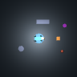

# Actual compact-planner input/output examples

For the full explanation, read [task flow](../../docs/TASK_FLOW.md).
[physical-trials.csv](physical-trials.csv) and
[physical-trace-summary.json](physical-trace-summary.json) are separately labeled
derived views of the existing 24 physical trials; they are not outcomes of the
eight static diagnostic inputs below.

These are **actual released v4 model predictions**, exported to make the task
interface inspectable. They are development examples, **not held-out evaluation
results**, physical task completions, or evidence of general language reasoning.
No training, Qwen inference, task execution, or paid infrastructure was used.

[motor-example.json](motor-example.json) also records actual deterministic CPU
PPO predictions: the shared 50-value standing observation, then the same input
with only its forward-command value changed to 0.35 m/s. It includes all twelve
residuals, their 0.3-radian scaling, measured parameter counts, checkpoint digest
and a reproduction command. No output was applied to a robot; the live motor
gate would suppress the standing prediction and apply zero residuals.



[examples.json](examples.json) contains all eight instructions, exact model-input
energy/held values, the shared 50-value motor observation, raw decoded intent and
six plan rows, softmax scores, targets, visibility, checkpoint digest and source
hashes. The checkpoint is the unchanged 246,712-parameter
`demo/arena-planner/planner.pt` with SHA-256
`a464d92e975ee86ae297ddc23ddab10b52c2f83460550468317b37f3f2b1ae89`.

| Input | Decoded intent | Six proposed skill/object rows, abbreviated |
| --- | --- | --- |
| `eat ball` | `approach` | `approach/ball` × 6 |
| `fetch the ball`, normal state | `fetch` | `retrieve/ball`, `return/home`, `stop/none` × 4 |
| `fetch the ball`, held-input intervention | `fetch` | `return/home`, `drop/none`, `stop/none` × 4 |
| `fetch the ball`, energy-input intervention | `fetch` | `rest/none` × 6 |
| `go behind the ball` | `behind` | `behind/ball` × 6 |
| `push the crate` | `push` | `push/crate` × 6 |
| `follow me` | `follow` | `follow/beacon` × 6 |
| `teach me French` | `stop` | `stop/none` × 6 |

The held example sets only the model's held bit to `true`. **No physical grasp
occurred.** The low-energy example sets only the model's virtual-energy input to
`0.10`. Both use the same image, motor observation, and physical world as every
other example. These interventions illustrate dependence on model inputs; they
do not demonstrate successful real-world sensing or manipulation.

The original bounded training grammar teaches `eat ball` as an approach/contact
alias and `follow me` as following the purple beacon. This does not implement
eating or identify a human. `behind` means the arena's +X side of the ball;
`push` means the fixed goal ring. The novel French request was classified as
`stop`, rather than `unsupported`: a safe stationary proposal in this example,
but evidence that unfamiliar-language rejection is not reliable. Softmax scores
are not calibrated probabilities of correctness.

Each row's `duration_s: 1.0` is fixed display metadata, not a learned duration or
a guarantee that the action completes in one second. In the live application,
`BrainSession` replans every **0.5 simulated seconds** and `GoalExecutor` consults
**row 0**. Its programmed physical controller retains goal phase and verifies
outcomes. The six rows are not executed blindly as six seconds of movement.
The compact planner's `drop/none` slot representation is separate from the
generative VLM mission schema, which requires `drop/ball`.

Reproduce from the repository root:

```bash
MUJOCO_GL=egl uv run --frozen python benchmarks/task-flow-examples/export_examples.py --out artifacts/task-flow-reproduction
```

[The exporter](export_examples.py) requires a new `--out` directory and refuses
an existing directory. It does not overwrite these published records. The
published examples were freshly generated with this exporter into
`artifacts/task-flow-examples-v2` before being copied here; the exact command and
source digests are recorded in `examples.json`.

It resets `PetEnv` with seed 77 and its existing
`randomize=False` configuration, then runs **100 control steps × 0.02 s = 2 s**
of zero motor residuals and a zero motion command to settle the standing pose.
It captures one actual 96×96 orthographic MuJoCo RGB frame, freezes the physical
scene, and performs CPU inference on each input. No subsequent physical step is
taken. Exported simulation time is approximately 2 s due to floating-point
accumulation. Renderer and floating-point differences may change exact pixels or
scores across machines; each export records its own inputs and hashes.

See [task execution source](../../src/robopup/executor.py),
[live replanning source](../../src/robopup/brain.py),
[generated training labels](../../src/robopup/planner_data.py), and the
[model card](../../docs/MODEL_CARD.md) for the complete boundary between learned
predictions, programmed skills, and physical verification.
