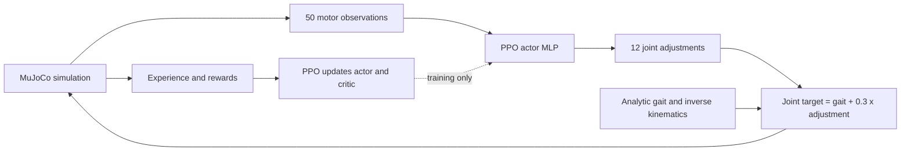
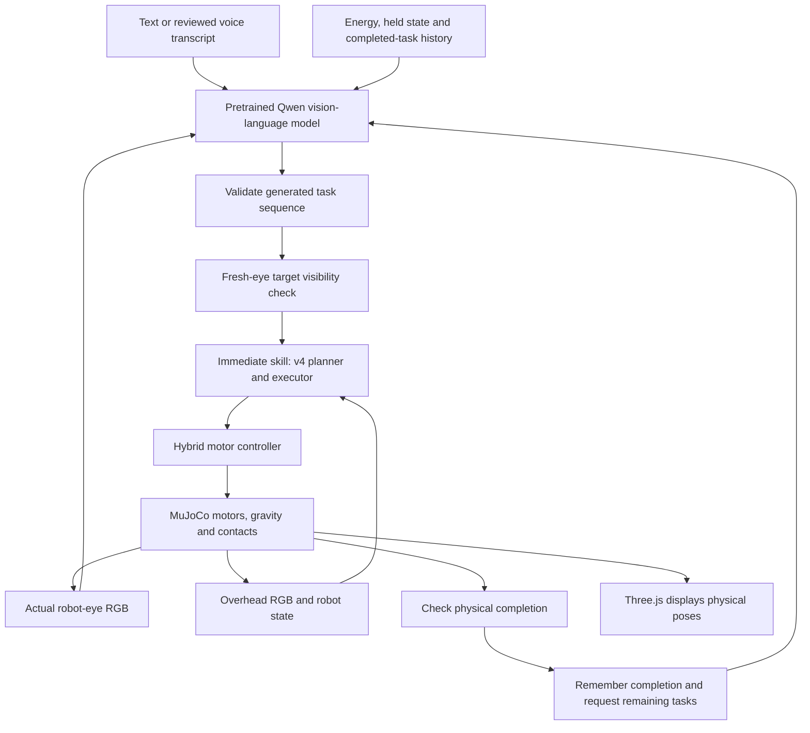
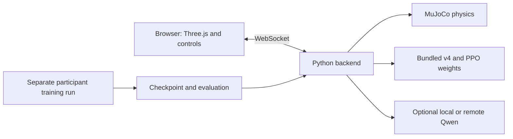

# RoboPup Arena, explained

We trained two small models: a PPO motor controller and an arena transformer.
We also integrated a much larger pretrained vision-language model. Together
with physical controllers and outcome checks, they form the prototype.

## What has been trained?

| Component | Architecture and size | How its weights were obtained | Job |
| --- | --- | --- | --- |
| Motor policy | Actor/critic MLP, 15,705 parameters total; deterministic actor 8,204 | Fresh networks trained with PPO | Adjust leg targets during near-straight trotting |
| Arena planner v4 | 246,712-parameter transformer, about 1 MB | Supervised learning from rendered arena images and generated instruction/action labels; GPU training followed by CPU decoder refinement | Recognize bounded commands, locate colored arena objects and propose skills |
| Qwen3-VL-2B-Instruct | Pretrained vision-language transformer, 2,127,532,032 parameters; 4.27 GB download | Public checkpoint downloaded unchanged; no RoboPup pretraining or fine-tuning | Generate a supported sequence of tasks from robot-eye RGB and an instruction |

The 821-parameter eye-visibility guard reuses the trained v4 pixel classifier.
It was not trained as another foundation model. A separate historical
`MultimodalPlanner` scaffold remains untrained and is not used by the arena.

[Exact sizes, checkpoint paths and licenses](MODEL_CARD.md).

## Where PPO is used

PPO means Proximal Policy Optimization. It is the reinforcement-learning
algorithm used to improve the motor network through simulated experience.
The network receives 50 numerical inputs describing motion, orientation,
joints, the requested movement, gait phase and its previous action. It produces
12 joint-target adjustments, one per leg actuator. Images and words do not enter
this motor network.



Rewards favor matching the requested forward speed and staying upright, and
penalize actuator effort, abrupt action changes and falls. The critic estimates
future reward during training. The actor supplies movement at inference time.

This is residual learning around an existing gait. The current walk, run, hop,
steering and magnetic pickup controllers are analytic physical skills; PPO did
not separately learn all of them. Live learned residuals are restricted to
near-straight trot. The recorded RTX 5090 locomotion experiment accelerated
batched **MJX physics on GPU**, while the small **PPO optimizer ran on CPU**.
The separate v4 transformer did use GPU optimization.

Playing in the browser does not update network weights. Participants train
new policies in separate experiment runs and then load their checkpoints.

## How an instruction becomes physical behavior

In optional generative mode, a command such as “fetch the ball, then hop, then
stop” follows this path:



The default compact mode sends a bounded command directly to v4 and the
executor, without calling Qwen. Qwen's optional planning path uses the robot's
perspective camera; v4 still uses overhead RGB to locate low-level targets.
The whole controller is therefore not an end-to-end eye-to-motor learned policy.

MuJoCo calculates body movement, collisions, the ball and the crate. Three.js
renders those physical poses. Fetch uses a contact-gated simulated magnetic
lifting tool. The controller checks grasping, lifting, returning and releasing;
hop completion requires measured flight and stable landing. A generated claim
of success is not accepted as physical completion.

The guard rejects an immediate object-directed action when its target lacks
confident pixel evidence. This guard is limited to the arena's colors. The raw
Qwen model failed a conditional visual probe by proposing fetch for real, blank
and turned-away views alike. Its reliable general visual reasoning, a learned
RoboJev-style judgment layer and fully onboard visual control remain incomplete.

## What is tested?

- Last full local validation: **226 Python tests**, Ruff and **21 browser tests**
  passed. Hosted CI passed for the tested application source.
- Compact v4 passed 24 varied-start physical trials across eight supported tasks.
- One actual guarded Qwen browser mission completed fetch, hop and stop, with
  independent physical checks. It took **403.79 seconds on CPU**, excluding
  setup/video encoding, with software WebGL on the same machine.
- A headless Qwen mission on a provider-reported RTX 4090 took **23.45 seconds**,
  with physics paused during inference. It predates the eye guard and is not
  a measurement of interactive GPU browser latency.
- Actual local Vercel gateway, injected internal binding, planner and native Qwen
  inference passed a planning request. Production Vercel is not deployed.

These bounded tests do not establish arbitrary object/language understanding,
real hardware, mobile performance, learned recovery, concurrent VLM capacity or
a complete two-hour workshop soak. The original robot and alternate puppy skin
are procedural artwork, not a photoreal canine asset.

[Validation and retained failures](VALIDATION.md) · [Current status](STATUS.md) ·
[Actual browser recording](../benchmarks/vlm-2026-10-16/browser-guarded/actual-run.webm).

## How people run it

The tested local platform is Linux with Python 3.11–3.13, Node 20.19+ or 22.12+,
`uv`, and EGL/Mesa (`libegl1 libgl1-mesa-dri` on Ubuntu).

```bash
git clone https://github.com/sanjuhs/robo-pup-decision-model.git
cd robo-pup-decision-model
bash scripts/setup.sh
bash scripts/start.sh
```

Setup installs locked dependencies, seeds verified bundled checkpoints, builds
the frontend and runs Python checks. It does not start a new training run or
download Qwen. The private local server uses port 8000. Each browser tab has its
own simulated world; all users still need a reachable Python backend.

For the large-model option, stop the server and run these commands **after**
baseline setup:

```bash
uv sync --frozen --extra dev --extra vlm
uv run --extra vlm python scripts/download_vlm.py
ROBOPUP_DEFAULT_BRAIN=vlm bash scripts/start.sh
```

The public pinned Qwen checkpoint needs no Hugging Face token. Its weights are
downloaded to ignored `artifacts/vlm/`; the small trained models are bundled in
`demo/`. CPU inference is slow, and model memory exceeds the downloaded file
size. A phone can display a backend-connected arena; a fully offline phone
bundle has not been implemented. Windows and Apple Silicon are unvalidated.



To train a distinct motor policy from fresh network weights:

```bash
uv run robopup-train --participant alice --run first-trick \
  --seed 101 --config configs/curious.json
```

Logs, configuration, checkpoints and evaluations go under
`artifacts/alice/first-trick/`. Participants can compare completed runs in the
arena. Queue training jobs rather than starting ten optimizers together; the
large VLM is optional for this workshop workflow.

[Workshop instructions](WORKSHOP.md) · [Full VLM setup](VLM_GUIDE.md) ·
[Vercel services and backend deployment](DEPLOYMENT.md).
