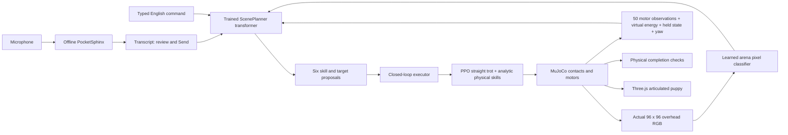

# The trained arena brain

The live prototype now connects actual MuJoCo RGB, text, numeric state, a trained
transformer and physical execution. It is a bounded simulated-domain agent.
It does not use a general vision-language model or a remote language API.



## Current v4 release

The default `ArenaPlannerV4` has 246,712 parameters and a 1,011,137-byte checkpoint.
It uses the same frozen arena pixel classifier and a GPU-trained fusion transformer
for intent. A separate learned 6,739-parameter decoder maps predicted intent, energy,
held state and slot index to skills, objects and offsets. This prevents nuisance
motor values from changing action logits for a fixed predicted task and needs.
Energy is linearly encoded as `(energy - 0.15) * 20`, centred on the existing virtual
rest threshold. The decoder learns the task table from supervised grammar labels.
This is a structured imitation model, with an analytic goal executor underneath.

The v4 GPU run took 101.13 seconds for 8,000 steps, after initializing from v3.
It used 6,000 seed-6119 poses: half static, half after 20 actual analytic-motion
steps. Each sample supplies one RGB frame, not a learned video history. Energy
and held state are crossed synthetically with poses for decision labels; these
are not demonstrations of completed physical fetch trajectories. The decoder
then received balanced synthetic task/state supervision on CPU for 87.26 seconds;
vision and transformer weights were frozen. The first CPU-stage records and final
normalized-stage selection are retained. All checkpoint selection used training
validation before the fresh final test was opened.

New final test: 500 seed-94871 mixed poses × 12 frozen new command templates,
6,000 state/command samples. Intent 100%, first action 99.967%, horizon skills
99.975%, object 99.95%, offset error 1.15 cm. Visible-object centroid error remains
7.10 cm against segmentation centroids; perception was frozen. All 24 fresh
physical trials passed, including three contact/lift/return/release fetches in
18.34–19.52 simulated seconds. The same v2 baseline took 74.44–77.36 seconds.
Push was slower (13.28–31.90 s vs 11.78–14.78 s). Small local tests do not prove
arbitrary-language/visual/general navigation competence or calibrated confidence.

v3's good language benchmark did not justify promotion: the unchanged settled-pose
held=1 regression still returned retrieve. That checkpoint is retained as rejected.
A v4 bootstrap failed on PyPI connectivity; its pod was deleted. The corrected
retry used all 52 locally hash-verified direct wheel URLs. The full
[protocol, failures, cost and results](GPU_PLANNER_EXPERIMENT.md) and
[raw records](../benchmarks/gpu-planner-v4) distinguish each stage.

The next section retains the earlier v2 training history; its test counts and
metrics belong to that historical release.

## Historical v2 training

The historical `ScenePlanner` in `src/robopup/scene_planner.py` has **232,414 parameters**:
small learned pixel classifier, object-centroid encoder, fixed word tokenizer,
state encoder, two width-96 four-head transformer layers and six plan queries.
The checkpoint is **946,381 bytes**, archived at `demo/arena-planner-v2/planner.pt`
with a SHA-256 sidecar, vocabulary, training report and release metadata.
No pretrained third-party model weights are downloaded.

Training used 1,800 independently rendered scene poses with randomized object
positions, robot yaw, small colour variations and lighting. The first 1,440 scenes
were training scenes and the last 360 validation scenes. Simulator segmentation
IDs supplied pixel labels during training only. The pixel model learns five
classes: background, ball, crate, home and beacon. Its confidently classified
pixels yield relative metric centroids using the calibrated orthographic camera.
The transformer receives these visual tokens, text and numeric state. This is
learned colour-domain perception, not object recognition in arbitrary photographs.

Supervised plan labels come from a task grammar and energy/held-state rules.
The planner was trained by imitation, **not reinforcement learning**; PPO trained
the separate motor MLP. Plans are not discovered autonomously or learned from
long-horizon task reward. The model is a fusion transformer, not an autoregressive
LLM or the return-conditioned offline-RL Decision Transformer architecture.

The first byte-tokenizer run failed held-out wording (68.3% intent accuracy).
The historical deployed retry uses a word tokenizer and reuses only that run's pixel encoder.
It achieved 100% validation intent accuracy and 99.2% first-action accuracy.
An untouched final test used 400 new seed-927 scenes and 12 new phrase compositions:
**97.875% intent, 89.542% first action, 89.25% horizon skills, 88.604% object choice**.
The new fetch wording was the weakness (74.5% intent); do not infer general language
competence from the aggregate score. Both failure and successful records are in
[`benchmarks/multimodal-2026-10-16`](../benchmarks/multimodal-2026-10-16).
No tuning followed this final test. Deployment uses the displayed finite commands;
uncertainty and invisible targets cause a hold, but confidence is not calibrated.

Visible-object centroid error was 7.21 cm against segmentation centroids on that
final test. This measures image-centroid agreement, not exact physical centre
localization. Input interventions changed plans for command, held state and energy;
shifting pixels by 8 columns moved the perceived target by 0.5 m, and blank RGB
removed visibility. These checks help distinguish actual visual grounding from
privileged-coordinate navigation.

## How plans become activity

Each row proposes a skill, object, relative target and confidence. The six rows
are a sequence of **fixed one-second chunks**, not predicted durations. The live
controller replans every 0.5 simulated seconds; it executes only the immediate
skill while a persistent executor tracks the goal. Later rows remain proposals,
not a promise that fetch completes in six seconds. Completed goals stop movement;
failed goals report a reason. Follow is a continuous tracking task.

The camera is a dedicated, north-up overhead MuJoCo sensor following the robot's
XY position. It is not the orbiting Three.js camera or an egocentric eye camera.
Live inference receives pixels and proprioception; true object coordinates are
not navigation inputs. Physical contact, held state and true positions are used
separately to verify outcomes. Navigation uses own pose, the image-derived target,
and specified task constants such as the crate goal `(3,0)`.

- Approach succeeds on robot/ball contact. Behind means the +X side of the ball.
- Fetch uses a **contact-gated magnetic lifting gripper**, not a canine mouth.
  A weld constraint preserves the contact pose; a slide actuator lifts the ball.
  Return, settling, lowering and release run in physics. No ball teleport or
  externally applied takeoff force is used. The verifier requires capture, lift
  above 0.2 m and release on the floor within 0.6 m of home.
- Push uses image-based alignment and contact to deliver the crate within 0.35 m
  of its goal. Follow is checked within 0.75 m of a moving beacon at 35 seconds.
- Walk uses a four-phase analytic leg schedule, run a faster diagonal schedule
  with measured flight, and hop a crouch/extend/landing controller. These are
  physical analytic skills, not learned canine gait policies. Walk still showed
  0.02–0.10 seconds without foot contact in the three short tests: it is not a
  biomechanically validated walking gait.
- The evaluated CPU curious-v2 PPO supplies residuals during near-straight trot.
  Steering and other skills use analytic targets. The bundled GPU walker remains
  selectable for locomotion comparisons; its manipulation performance differs.
- Play-energy is a virtual game variable based on activity and a torque/velocity
  proxy, with recharge at rest. It is not a battery, joules or biology. The model
  can propose rest, and the executor uses recharge hysteresis before resuming.
- Falls request a reset. Recovery and self-righting are not learned.

The historical v2 canonical eight activities passed **24/24 headless RGB trials** across seeds
101, 202 and 303 with small initial yaw/object changes. Fetch took 71.86–78.16
simulated seconds. This is a small local benchmark, not arbitrary-layout success.
The original failed retrieval pilot is retained alongside the corrected trials.

## Voice

The browser records up to six seconds through an AudioWorklet, resamples to
mono 16 kHz PCM and sends it to this server. PocketSphinx runs offline with a
finite English command grammar; its dependency includes an approximately 28 MiB
speech model. No audio is persisted or sent to an external transcription service.
A transcript fills the text box and requires Send. This lets the user correct
recognition before movement. Microphone capture needs HTTPS or localhost.

The synthetic Flite fixture says “fetch the ball.” The real decoder and API have
been tested against it. Browser tests exercise capture, worklet, WAV transfer and
transcription using fake microphone audio. That is plumbing evidence, not an accent,
noise or real-human speech recognition benchmark. Unsupported speech may be
misrecognized as a supported command; always inspect the transcript.

## Reproduce and extend

```bash
uv run python -m robopup.planner_data --out artifacts/my-scenes --scenes 1800 --seed 61
# Fresh pixel encoder and transformer; this is a new run, not bitwise replay of v2.
uv run python -m robopup.train_planner --data artifacts/my-scenes --out artifacts/my-brain --steps 1600
# Optional: reuse the bundled, trained pixel encoder for a new transformer experiment.
uv run python -m robopup.train_planner --data artifacts/my-scenes --out artifacts/my-brain-warm --steps 1600 --perception demo/arena-planner
uv run python -m robopup.planner_data --out artifacts/test-scenes --scenes 400 --seed 927
uv run python -m robopup.evaluate_planner --model demo/arena-planner --data artifacts/test-scenes --out artifacts/my-planner-test.json
uv run python -m robopup.evaluate_pet --model demo/arena-planner --out artifacts/my-goal-trials.json
```

Training output directories are exclusive and include weights, SHA-256, metrics
and progress. New runs capture source/data/initialization hashes before training.
The actual v1/v2 experiments preceded that provenance capture: raw reports,
seeds, data hashes and checkpoint lineage are retained, but their initial
uncommitted source snapshot was not saved. Exact bitwise reproduction is not
asserted. See `demo/arena-planner-v2/release.json`.

The old `planner.py::MultimodalPlanner` remains an **untrained 769,149-parameter
research scaffold** for image histories/byte tokens and different output heads.
It is not the deployed architecture. Its tensor tests do not validate this agent.

Remaining research: broader language and visual domains, egocentric perception,
learned yaw and manipulation, calibrated success prediction, long-horizon data,
physical canine rig/retargeting and browser-only WASM simulation/inference.
A larger pretrained VLM needs a separate license/resource/evaluation decision;
none is silently downloaded. The robo-jev inspiration is architectural: its
audited README describes text sensory descriptions and Qwen3.5-2B LoRA judgments.
Its weights/code and benchmark claims are not reproduced here.

## Reproduce v4 training stages

The archived v3 checkpoint is an explicitly rejected application model used as
initialization, not a recommended demo controller. Only launch a paid pod with
session authorization and the external lifecycle monitor.

```bash
python3 scripts/runpod_planner_experiment.py --candidate v4 --out artifacts/my-gpu-attempt
# After retrieval/deletion; this trains only the small decoder on CPU.
uv run python -m robopup.refine_decoder --source artifacts/my-gpu-attempt/runpod/planner-v4/weights --out artifacts/my-refined-brain
uv run python -m robopup.planner_data --out artifacts/my-final-scenes --scenes 500 --seed 94871 --rollout-steps 20 --static-fraction .5
uv run python -m robopup.evaluate_planner --model artifacts/my-refined-brain --data artifacts/my-final-scenes --curriculum v4 --out artifacts/my-final-test.json
```

The checked-in final set is now a regression benchmark for future changes; a new
claim of untouched generalization requires another frozen test. Exact bitwise
reproduction across different GPU drivers is not asserted. GPU packages/hashes,
actual runtime, source/data hashes and decoder lineage are recorded.
