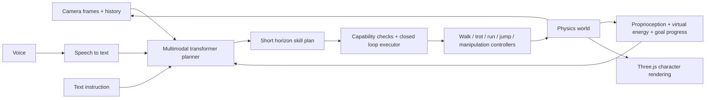

# A puppy that sees, understands, and acts

This is the next-stage design and a description of the untrained tensor scaffold.
It is not a report of a trained multimodal agent. No additional GPU run was started.



## The two control rates

Use a slower planner, initially targeting 1–2 updates/second, and a motor policy
at the existing 50 Hz. These are design targets; planner latency is unmeasured.
For “fetch the ball,” the planner can propose approach → grasp → return → release.
The executor carries out only the next available step, checks progress/contact,
and replans from observations. Avoid executing a long fixed sequence while
the world changes. The horizon is a proposal, not a claim about future certainty.

A useful six-row plan has skill, target relative to the puppy, forward/yaw
command, duration, predicted success, and collision/fall/energy risks. Add
preconditions and stop/completion rules in the executor. Probabilities require
calibration on held-out outcomes; softmax/sigmoid alone do not calibrate them.

The current simulator knows object coordinates. They can label training data,
but a vision claim must be evaluated using pixels rather than feeding those
privileged coordinates into the deployed planner. Use an explicitly labelled
oracle baseline to measure how much perception costs.
Grasp/release in the example are future executor states; the scaffold's retrieve
label does not implement them or include separate jaw-control outputs.

## Executable scaffold now present

`MultimodalPlanner` is an ordinary PyTorch module with:

- Up to four 96×96 RGB observations, divided into 16×16 patches.
- Up to 96 UTF-8 byte tokens; this has no pretrained language understanding.
- One 53-value state per frame: the current 50 motor observations plus proposed
  virtual energy, goal progress, and elapsed goal time. The three extra signals
  are not populated by the live arena yet.
- A three-layer, width-128, four-head transformer and six learned horizon queries.
- Skill logits for stop/walk/trot/run/jump/approach/retrieve/return/rest/recover,
  2D relative targets, forward/yaw commands, duration, and four outcome logits.

There are 769,149 parameters. Six proposed durations are bounded to 0.25–2 seconds
per slot, so the represented horizon can span 1.5–12 seconds. The module validates
input shapes and finite/range conditions. It is a fusion transformer, not a
return-conditioned offline-RL Decision Transformer implementation or a language
generator. Its vocabulary lists future skills; listing a skill does not implement it.

Only tensor flow and gradients have been tested. No model was trained or saved;
no live RGB capture, speech recognition, semantic object perception, planner
execution, or multimodal task success is claimed. Random predictions must never
be wired into the arena. The existing rule hierarchy remains the controller.

```python
# Tensor contract demonstration only; outputs have no learned meaning.
import torch
from robopup.planner import MultimodalPlanner, encode_instruction

planner = MultimodalPlanner().eval()
with torch.no_grad():
    outputs = planner(
        torch.zeros(1, 4, 3, 96, 96),
        encode_instruction("fetch the ball").unsqueeze(0),
        torch.zeros(1, 4, 53),
    )
assert outputs["skill_logits"].shape == (1, 6, 10)
```

## A practical training path

1. Record synchronized RGB/history, instruction, proprioception, goal progress,
   action, contact, energy proxy, and outcome. Keep episode/source provenance.
   Collect unsuccessful actions and counterfactual branches as well as successes.
2. Train reliable low-level commanded speed/yaw skills before asking a planner
   to use them. For the initial planner, mask every unavailable skill and stop
   when the chosen action cannot execute.
3. Use a frozen pretrained vision/text encoder or compact VLM for useful
   recognition and instruction semantics. Train a small fusion/action head, or
   LoRA-tune a suitable pretrained backbone after auditing its weights' license.
   Training useful general image/language understanding from scratch is not a
   credible use of the remaining $30 budget. The fresh patch/byte scaffold is
   suitable for controlled research, not a substitute for pretrained competence.
4. Split datasets by whole episode and held-out layout/object/lighting/wording;
   overlapping frames from one trajectory must not leak across splits. Compare
   rules, oracle-state planning, and RGB planning. Measure success/return, falls,
   collision rate, energy proxy, calibration, plan latency, and actual rental cost.
5. Start with boop, approach, behind, and stop. Add carry/retrieve only after
   grasp mechanics and return/release pass physical tests. Export for browser
   use only after the native controller and observation interfaces agree.

Using a 1–3B pretrained VLM is an alternative, with stronger semantics but larger
downloads and compute. A 2B backbone's raw parameters alone are roughly 4 GB in
16-bit or 1 GB in 4-bit, before quantization metadata, cache, activations, vision
components, or runtime. Exact devices/speeds/memory must be benchmarked. A small
frozen-encoder/fusion stack may be easier to deliver locally; its size depends
on the selected audited encoders. Neither option is downloaded or integrated now.

## What the requested skills actually require

| Capability | Current state | Work required |
| --- | --- | --- |
| Walk | Slow speeds available, but still a diagonal trot | Four-beat contact schedule, commanded speed/yaw curriculum, held-out tests |
| Trot | Analytic prior plus evaluated PPO residuals | Better heading/lateral stability and smooth transitions |
| Run | Faster CPU profile exists; no validated flight-phase gait | Train aerial/contact timing and stable acceleration/braking |
| Jump | Not implemented | Takeoff, aerial posture, landing contacts, recovery, reward/curriculum and tests |
| Fetch/carry | Approach and ball contact only | Jaw/gripper or an explicitly labelled nonphysical attachment demo; physical grasp/hold, return, release and outcome tests |
| Voice | Not implemented | Speech-to-text, microphone UI/permissions, transcript grounding and evaluation |
| Vision | No pixels enter the live controller | Camera synchronization, trained perception, occlusion handling and held-out visual tasks |
| Energy/personality | Squared-torque cost only | Explicit virtual battery/needs dynamics, speed/rest tradeoffs; do not label this as measured biology or battery energy |

A prettier skin can improve presentation immediately. It cannot turn a trot
into a physically learned jump or add a missing gripper. Synthetic root movement,
ball teleporting, or playing a jump clip would need to be labelled animation-only.

## Relationship to robo-jev

The audited [robo-jev README](https://github.com/STEERIX-home/robo-jev/blob/235a0e824675bd0dbf23436543e231f2bda1f6df/README.md)
says it “reads a short text of what a robot senses” and describes a Qwen3.5-2B
backbone with a LoRA adapter for physical judgment probabilities. That documented
interface does not establish a camera-and-voice pipeline or locomotion controller.
We have not reproduced its benchmark claims or copied its source/weights. Its
separation of physical judgment and motor control is the useful inspiration.
