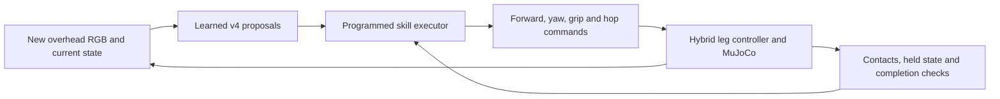
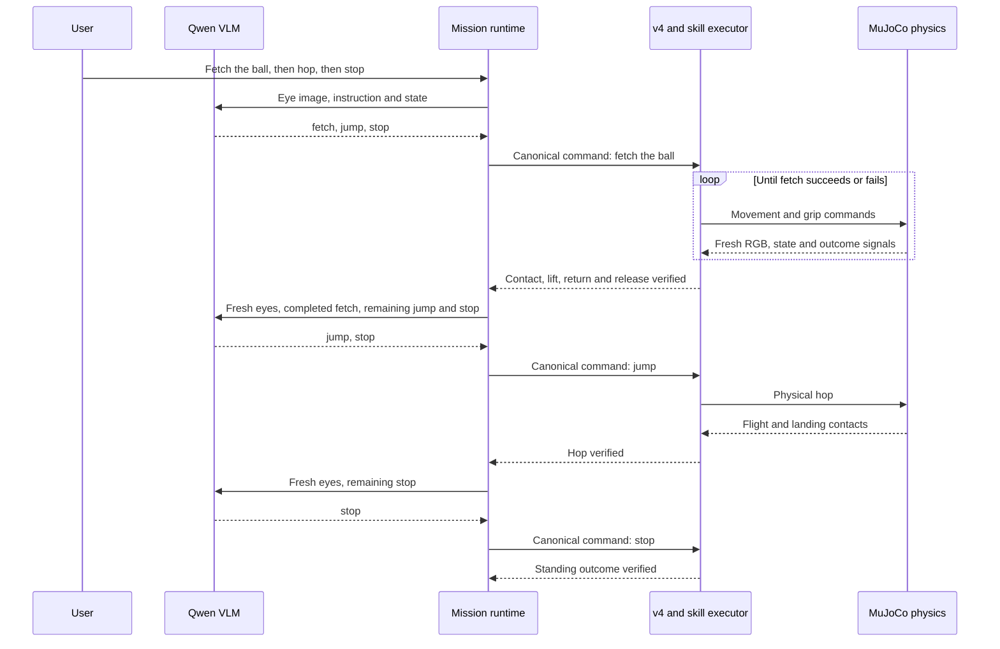

# What the motor controller, arena planner and Qwen each decide

The motor controller adjusts leg movement. The arena planner maps a bounded
instruction and current observations to a task and visual target. Between them,
a programmed **skill executor** handles navigation, manipulation phases and
physical outcome checks. Optional Qwen chooses a sequence of those supported
tasks from the user's instruction and robot-eye RGB.

## The interfaces

| Component | Input | Output | When it runs |
| --- | --- | --- | --- |
| Qwen3-VL | 384×384 perspective eye image, instruction, energy, held bit, verified history | JSON task sequence such as fetch → jump → stop | Initially and between completed mission steps |
| Arena planner v4 | 96×96 overhead RGB, one canonical instruction, 53 numerical state values | Intent and six skill/object/relative-target proposals | Every 0.5 simulated seconds during an active compact skill |
| Programmed executor | Learned intent/target, own pose, current skill phase and outcome signals | Forward/yaw commands, gripper commands, hop requests, completion/failure | Every control step |
| PPO motor actor | 50 numerical motor observations, including movement command | 12 joint-target residuals | 50 Hz where learned straight-trot residuals are enabled |

The motor policy has no image or text input. The actor's 12 residuals are added
to an analytic gait. Analytic controllers also supply steering, walk/run, hop
and grip behavior. MuJoCo advances physics at 200 Hz.

[Actual motor input/output data](../benchmarks/task-flow-examples/motor-example.json)
contains the recorded 50-value observation, twelve deterministic PPO residuals
and their radian adjustments. Its forward-command case is an explicit input
intervention, with no physical rollout. The standing output would be suppressed
by the live motor gate.

## What “bounded commands” means

v4 was trained on this arena's small task vocabulary, colored objects, and
generated phrase variations. These examples have specific meanings:

| Instruction | Arena meaning |
| --- | --- |
| `eat ball` | Approach and physically touch the ball; no eating behavior |
| `fetch the ball` | Retrieve with the simulated magnetic tool, return to home, lower and release |
| `go behind the ball` | Move to the arena's +X side of the ball |
| `push the crate` | Push the orange crate toward the fixed ring at `[3, 0]` |
| `follow me` | Track the purple moving beacon; no human detection |
| `rest` | Recharge virtual play-energy |

Different object identities, arbitrary landmarks and unfamiliar instructions
are outside that training domain. Unfamiliar wording can be misclassified: in
the [saved actual predictions](../benchmarks/task-flow-examples/examples.json),
`teach me French` produced `stop`, rather than a reliable unsupported-request
classification. Softmax scores are not calibrated correctness probabilities.

## What the arena planner learns

Its visual module learns arena pixel classes and object locations from RGB.
The transformer predicts intent; its learned task/needs decoder uses that
predicted intent, virtual energy, held state and proposal-slot index to produce
skill/object/offset predictions.

These are representative teacher-label cases from the actual label function,
not quotations of individual stored training samples:

| Instruction / state | First teacher proposal |
| --- | --- |
| Fetch, energy 0.9, not holding | `retrieve / ball` |
| Fetch, energy 0.9, holding | `return / home` |
| Fetch, energy 0.1, not holding | `rest / none` |
| Push, energy 0.9 | `push / crate` |
| Behind, energy 0.9 | `behind / ball`, with +X offset |

The training generator rendered 6,000 MuJoCo scenes: 4,800 training and 1,200
validation scenes. Training samples combined scenes with generated phrases and
held/energy states; authored label rules supplied skill/object targets. This
was supervised learning, not PPO learning of complete fetch trajectories.
Simulator segmentation supplied offline pixel labels and is not live model
input. The released v4 inherited earlier vision weights and received subsequent
GPU training and CPU-only decoder refinement.

[Training manifest](../benchmarks/gpu-planner-v4/attempt2/training-data.json) ·
[Teacher rules](../src/robopup/planner_data.py) ·
[Training history and tests](GPU_PLANNER_EXPERIMENT.md).

The new [eight actual v4 examples](../benchmarks/task-flow-examples/README.md)
include one real RGB image and complete decoded outputs. Their held and energy
cases are explicitly labeled input interventions on the same physical scene;
setting the held input did not physically grasp the ball. These are explanatory
diagnostics, not new held-out results or physical successes.

## Proposals versus execution

v4 emits six proposal rows with a fixed `duration_s: 1.0`. Duration is display
metadata, not a learned completion-time estimate. Only the first row guides
current execution, and a fresh image produces another plan every half simulated
second. It does not execute six rows blindly for six seconds.

The executor uses learned intent, target, visibility and confidence, while
retaining its own programmed skill phase. In fetch, it navigates toward the
ball, enables contact-gated pickup, returns using the image-derived home target,
settles, lowers, releases and verifies the result.



This is a **real saved fetch trajectory**, seed 707:

| Simulated time | Physically holding | First v4 proposal | Executor phase |
| --- | --- | --- | --- |
| 0.00 s | No | retrieve / ball | planning |
| 0.50 s | No | retrieve / ball | retrieving |
| 5.70 s | Yes | return / home | returning |
| 16.82 s | Yes | return / home | settling |
| 17.86 s | Yes | return / home | lowering |
| 18.38 s | No | retrieve / ball | release |

After release, v4 proposes retrieving again because the held bit is false.
The executor's persistent release phase instead checks the completed fetch.
At 19.52 s it verified success, with one grasp and maximum held-ball height
0.3557 m. This demonstrates why the executor's memory matters: a fresh learned
proposal alone is not the whole policy.

[Derived phase trace](../benchmarks/task-flow-examples/physical-trace-summary.json)
links and hashes the unchanged original physical record.

## How Qwen commands the arena planner

The connection is ordinary Python data handling. Qwen generates a bounded JSON
mission. The validator accepts supported action/object pairs, and a mapping
converts the current step into a canonical instruction for `BrainSession`.

Correctly interpreting an arbitrary user goal still depends on the VLM; schema
checks establish supported action pairs and format, rather than language quality.

For example, this is the parsed first response from the actual GPU mission:

```json
{
  "summary": "Fetch the red ball, then hop, then stop.",
  "steps": [
    {"action": "fetch", "object": "ball"},
    {"action": "jump", "object": "none"},
    {"action": "stop", "object": "none"}
  ]
}
```

The current `{action: fetch, object: ball}` step becomes `fetch the ball`.
That instruction enters v4 repeatedly with fresh RGB/state while the executor
completes fetch. Qwen's output is not sent directly to joint motors, and no
network weights change during this interaction.



Before each step activates, a separate learned pixel guard checks fresh eye RGB
for any required target. Remaining-task memory prevents a replan from repeating
completed tasks or replacing the remembered goal sequence. The runtime requests
a new plan only after the current step's physical or bounded-duration contract
passes. Model/schema failures, ungrounded targets and failed outcome checks are
visible failures, rather than permission to skip a task.

The actual GPU mission made three calls:

| Call | Verified history supplied | Generated remaining tasks | Model wall time |
| --- | --- | --- | --- |
| 1 | None | fetch → jump → stop | 9.882 s, including load |
| 2 | Fetch completed | jump → stop | 5.567 s |
| 3 | Fetch and hop completed | stop | 5.405 s |

These are [real saved responses](../benchmarks/vlm-2026-10-16/gpu-4090/mission/),
not protocol fixtures. That headless experiment paused physics during thinking
and predates the new eye guard. The separate guarded browser run is retained
in the [browser evidence](../benchmarks/vlm-2026-10-16/browser-guarded/).
The earlier raw Qwen conditional-vision failures remain unresolved model-quality
limitations despite the controller's additional guard.

## Physical task data

The existing compact-v4 evaluation passed three starts each for eight tasks:

| Task | Passed | Simulated execution/test time |
| --- | --- | --- |
| Approach/contact ball | 3/3 | 5.48–5.74 s |
| Behind ball | 3/3 | 30.36–89.68 s |
| Fetch | 3/3 | 18.34–19.52 s |
| Push crate | 3/3 | 13.28–31.90 s |
| Follow beacon | 3/3 | 35.02 s fixed tracking trial |
| Walk 0.5 m | 3/3 | 2.48–2.50 s |
| Run 1.2 m | 3/3 | 2.78–3.22 s |
| Hop | 3/3 | 1.62 s |

[Download the 24-trial CSV](../benchmarks/task-flow-examples/physical-trials.csv).
These are simulated task/test durations, not training times or Qwen call times.
They use compact v4, the default PPO hybrid and programmed skills. Three starts
per task do not establish broad generalization. The follow trial measures
tracking over a fixed window; optional Qwen `follow` steps have a separate
four-second duration contract. Physical task success and agreement with teacher
labels are different measurements.
