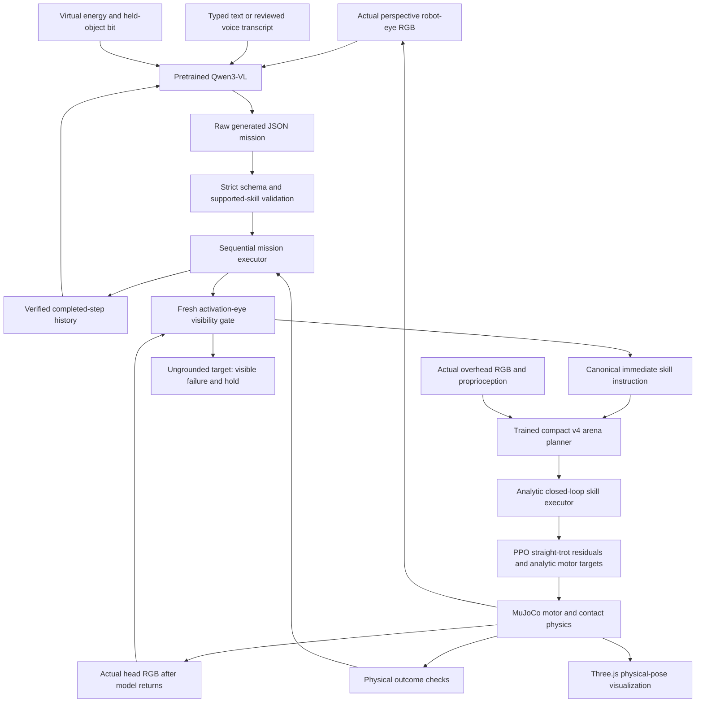

# The large vision-language model and the robot

The large model option is
[**Qwen/Qwen3-VL-2B-Instruct**](https://huggingface.co/Qwen/Qwen3-VL-2B-Instruct),
a pretrained 2B-class image/text model. RoboPup provides its runtime and sequential
mission interface. It is separate from the **246,712-parameter v4 arena planner**
and the small PPO motor policy. Downloading or serving Qwen does not train a new
LLM, and this project does not claim to have pretrained one from scratch.

This guide describes implemented interfaces. Genuine model inference, valid JSON,
and a completed physical mission are separate results. Until linked measurement
records establish each one, configuration and contract tests alone do not prove
VLM task competence. See [VALIDATION.md](VALIDATION.md) for the recorded checks and
[STATUS.md](STATUS.md) for the current release's scope.

**Actual guarded browser result:** a complete real-Qwen fetch → hop → stop mission
passed with the native eye gate, MuJoCo and Three.js, without a response fixture
or world reset. It took **403.790 mission wall seconds**, excluding setup, with
real CPU calls of **161.999, 110.580 and 104.788 seconds**. Physics kept standing
during the waits. Independent checks recorded contact, a **0.3621 m** held lift,
release **0.3901 m** from home at fetch completion, and **0.28 s** flight followed
by a four-foot landing. The [uncropped original-time recording and result](../benchmarks/vlm-2026-10-16/browser-guarded)
retain the waiting as well as motion. This is one canonical pass with long CPU
latency, not a general visual-reasoning or GPU browser-responsiveness claim.

**Measured genuine-model result:** the corrected native CPU trial of "Fetch the
red ball, then hop, then stop" passed all twelve physical/trace checks with three
actual Qwen calls. It took **183.27 wall seconds for 19.98 simulated seconds**;
physics was paused while the model generated. The [saved eye images, unedited
responses and physical result](../benchmarks/vlm-2026-10-16/cpu-verified-mission)
are separate from the controlled fixtures used in protocol/runtime tests. This
single corrected headless trial does not establish real-time browser behavior
or general vision-language task success. An earlier genuine repeated-fetch
[failure is retained](../benchmarks/vlm-2026-10-16/cpu-rejected-replan).

A separate [actual RTX 4090 run](../benchmarks/vlm-2026-10-16/gpu-4090) completed
the same corrected native mission in **23.45 wall seconds / 19.98 simulated
seconds**, again pausing physics during model inference. Its three calls took
9.882, 5.567 and 5.405 seconds. The pod was deleted and absence verified; GPU cost
was approximately **$0.0833**, with cumulative confirmed-experiment GPU estimates
about **$0.79**, not a final invoice.

**Visual semantic grounding failed its probe:** conditional real, blank and
turned-eye images all produced look → fetch → stop. The blank frame should have
prevented fetching under that instruction. Seven schema-valid outputs therefore
do not establish seven correct decisions or reliable vision-based planning.
Successful fetch/hop execution used the separate overhead-v4 controller; it does
not resolve this high-level visual failure. Raw failed responses are retained.

The native controller now adds a separate [activation-image visibility
guard](../benchmarks/vlm-2026-10-16/eye-grounding/probe.json). It reuses 821 trained
v4 pixel weights unchanged and recaptures actual head RGB after Qwen returns.
Its small same-color/same-renderer probe had 18 visible and 50 negative object/view
pairs across seventeen fresh views, with no observed false positives/negatives.
This is limited developmental evidence, with engineering thresholds rather than
calibrated probabilities. The guard visibly rejects an ungrounded target action;
it does not rewrite the model's plan or improve Qwen's raw visual judgment.
The successful earlier CPU/GPU mission timing records predate this addition.

The loaded model has **2,127,532,032 parameters**; its downloaded snapshot totals
**4,266,647,442 bytes**, pinned to revision
`89644892e4d85e24eaac8bacfd4f463576704203`. See the
[provenance manifest](../benchmarks/vlm-2026-10-16/model-manifest.json) and
[benchmark details](BENCHMARKS.md). No Qwen pretraining or fine-tuning occurred.

## How an instruction becomes motion



This is the **native MuJoCo path**. The generative planner receives a real
384×384 perspective image from a robot-head-mounted simulated camera. It does
not receive simulator object coordinates, a scene graph, segmentation labels,
or hidden target locations. Energy is a virtual activity variable; `held` is a
physical gripper-state bit. One image is attached per request, with a fresh image
when the native mission engine replans between steps. It does not stream video
or raw audio into the VLM.

Text is tokenized by Qwen's own pretrained tokenizer, and image patches pass
through its pretrained vision encoder into the language model. The downloaded
configuration specifies a 24-layer vision transformer with width 1,024 and a
28-layer language transformer with width 2,048. These are model-architecture
configuration values, not an independent model-quality benchmark. RoboPup does
not fine-tune either part during inference.

The VLM chooses a high-level sequence. The native v4 planner turns the immediate
canonical instruction into its familiar skill/object/relative-target proposals.
Its arena perception still uses **96×96 overhead RGB**, own pose and proprioception;
the analytic executor follows those proposals and checks physical completion.
The eyes are real planning input, but low-level control has not been replaced by
a fully egocentric learned policy. Behind means the arena's +X side of the ball;
fetch returns to the fixed home area, and push targets the marked crate goal.

Voice capture uses separate offline PocketSphinx recognition with a finite
English command grammar. The user reviews the transcript and presses Send.
This is speech-to-text followed by vision/text planning, not a raw-audio VLM.

## What the model is allowed to request

The output is a small JSON mission, for example:

```json
{
  "summary": "Fetch the ball home, then hop.",
  "steps": [
    {"action": "fetch", "object": "ball"},
    {"action": "jump", "object": "none"}
  ]
}
```

That is an **illustration of the contract**, not a recorded model response.
`fetch` already includes contact, lift, return, lowering and release. It is not
just a cosmetic attachment animation.

| Supported action | Object | Current execution boundary |
| --- | --- | --- |
| `approach`, `behind`, `fetch` | `ball` | Existing native v4 arena skills |
| `push` | `crate` | Push toward the specified crate goal |
| `follow` | `beacon` | At most 4 simulated seconds per step |
| `walk`, `run` | `none` | Forward motion, bounded to 4 or 3 simulated seconds |
| `jump` | `none` | One physical hop and verified landing |
| `rest` | `none` | Recharge virtual energy; bounded wait |
| `drop` | `ball` | Release the gripper |
| `stop` | `none` | Settle to a standing pose |
| `look`, `turn_left`, `turn_right` | `none` | Explicit direct skills; look holds still, turns last at most 1.5 simulated seconds |

The validator accepts at most eight steps per generated plan and rejects extra
properties, unknown actions, unsupported action/object pairs, duplicate JSON
keys, non-finite values, malformed JSON and responses above 12 KB. There is no
`eval`, arbitrary tool execution, or language-to-shell path. A model cannot add
an unsupported skill by describing it in the summary.

The native mission engine executes one step, verifies its outcome, then requests
a fresh plan for the remainder when more steps were proposed. It includes
completed history to discourage repetition. It limits the mission to seven
replans, sixteen accumulated steps, **360 simulated execution seconds excluding
model wait**, and **30 minutes wall time**. Continuous steps
can finish at their duration bound; a fetch/push timeout is a failure. A stop or
mode change can cancel application of a pending plan. An inference thread may
still finish internally, but its canceled result cannot start the old mission.

The high-level generator runs separately from the simulation event loop. While
it is thinking, the robot holds position; duplicate mission requests are rejected
as busy. Malformed output or provider failure is shown as a failure. The compact
planner is not substituted while presented as an LLM response.

## What the eye-visibility gate adds

A model-generated target name is not evidence that the target is visible. Just
before native step activation, a fresh eye image passes through the released v4
pixel classifier alone. Its 821 parameters are copied unchanged from the
checksum-verified checkpoint; the overhead metric projection is not reused.
No simulator positions, segmentation masks, object IDs or visibility labels enter
this inference. The model remains a learned arena-color classifier, not a new
foundation-model detector.

Approach, behind and fetch require ball evidence; push requires crate evidence;
follow requires beacon evidence. Fetch may return an already physically held
ball. Look/turn, untargeted motion/rest/stop and drop can proceed without a visual
target. If the immediate target is ungrounded, the mission reports the reason and
holds movement. It does not automatically pick a new action or hide the failed
proposal. In particular, the failed raw Qwen blank-image fetch remains a failed
visual decision even though the new controller would block its execution.

At 384×384, a target needs a connected region of at least 64 pixels, each qualifying
at classifier posterior ≥0.9. The area scales with frame size with a four-pixel
floor. These are engineering abstention thresholds, not calibrated probabilities.
An object can be present but ungrounded because it is too small, hidden, shadowed
or outside the learned colors.

The [saved probe](../benchmarks/vlm-2026-10-16/eye-grounding/probe.json) includes
seven recorded views and seventeen fresh physical views. Offline renderer IDs
were used only to score the fresh images (visible truth: at least 64 pixels).
The 18 positive / 50 negative object-view results with zero observed mistakes
are a small developmental check in the same renderer and color domain. The probe
alone does not establish general visual recognition or a physical mission; the
separate actual browser result above verifies one guarded sequence.

## Where the weights live and how large they are

| Model | Storage | Size and training |
| --- | --- | --- |
| Compact v4 planner | [`demo/arena-planner/`](../demo/arena-planner) | 246,712 parameters; 1,011,137 bytes; supervised arena training here |
| Default PPO motor | [`demo/curious-v2/policy.zip`](../demo/curious-v2/policy.zip) | 224,113-byte archive; 15,705 actor/critic parameters; separate locomotion training |
| GPU PPO comparison | [`demo/5090-once/policy.zip`](../demo/5090-once/policy.zip) | 259,942-byte archive; same parameter count |
| Large VLM | Hugging Face model repository, downloaded under `artifacts/vlm/Qwen3-VL-2B-Instruct/` | 2,127,532,032 parameters; 4,266,647,442-byte downloaded snapshot; inference only, not bundled in GitHub |

`artifacts/` is ignored by Git. The model-download script resolves an immutable
Hub revision and writes a local `robopup-model-manifest.json` with source,
license, file sizes and SHA-256 digests. That manifest is the place to read the
exact downloaded size and revision; a model name alone is not a provenance
record. Loading an FP32 CPU copy can consume more memory than the BF16 weight
files, and inference needs activations/cache in addition to model weights.

A Hugging Face **model repository** stores weights; a **Space** hosts an app.
RoboPup has not published a new model or Space there. Qwen's model card declares
Apache-2.0. The tiny v4 checkpoint is not Qwen compressed to 1 MB; it is a different
trained network with a much narrower task.

## Download and run locally

From the repository root, install the optional frozen dependencies and download
the public model explicitly:

```bash
uv sync --frozen --extra dev --extra vlm
uv run --extra vlm python scripts/download_vlm.py
```

The default Qwen download is pinned to
`89644892e4d85e24eaac8bacfd4f463576704203`; other explicitly selected models default
to `main`, which is resolved to an immutable commit before downloading. An explicit
`--revision` overrides the selection and is recorded in the manifest. The runtime
never downloads weights merely because a browser makes an inference request.

The lock currently includes `huggingface-hub==0.36.2`. Its CLI commands are
`hf auth login` and `hf download`. For an operator who wants the direct Hub CLI,
this also downloads the public model, although the project script adds the
RoboPup provenance manifest:

```bash
uv run --extra vlm hf download Qwen/Qwen3-VL-2B-Instruct \
  --revision 89644892e4d85e24eaac8bacfd4f463576704203 \
  --local-dir artifacts/vlm/Qwen3-VL-2B-Instruct
```

**No Hugging Face token is required for this public model.** A token is useful
when access is required for a gated/private model, when publishing under an
account, or for an authenticated download allowance. If needed, use interactive
`uv run --extra vlm hf auth login` or a private runtime `HF_TOKEN` secret binding.
Do not pass a real token in an example, a browser `VITE_` variable, a GitHub file,
or command-line history. Do not use `--add-to-git-credential` for this setup.

Build the web UI using the normal [setup instructions](../README.md), then start
the native server with the checkpoint path configured:

```bash
ROBOPUP_VLM_MODEL_DIR=artifacts/vlm/Qwen3-VL-2B-Instruct \
  uv run --extra vlm uvicorn robopup.server:app --host 127.0.0.1 --port 8000
```

Open `http://localhost:8000`, select the generative VLM brain, and inspect its
status before sending a mission. `/api/vlm` distinguishes an absent checkpoint,
available files, a loaded model, generation and failures. An available checkpoint
is not a successful-inference claim. CPU inference may be slow. The default
project Torch installation is CPU-oriented; GPU inference needs a CUDA runtime
matched to the host, not just a GPU name in a configuration file.

To record a real inference independently of motion, capture an actual eye image
and run the probe. This example creates the image from the live simulator:

```bash
uv run python - <<'PY'
from pathlib import Path
import numpy as np
from PIL import Image
from robopup.pet import PetEnv
from robopup.vision import EyeCamera

env = PetEnv()
env.reset(seed=7)
env.command[:] = 0
for _ in range(25):
    env.step(np.zeros(12))
camera = EyeCamera(env)
try:
    Path("artifacts/vlm-input").mkdir(parents=True, exist_ok=True)
    Image.fromarray(camera.capture()).save("artifacts/vlm-input/eye-start.png")
finally:
    camera.close()
    env.close()
PY
uv run --extra vlm python scripts/vlm_probe.py \
  --image artifacts/vlm-input/eye-start.png \
  --instruction 'Fetch the red ball, then hop' \
  --output artifacts/vlm-probe.json
```

The probe records the image digest, model/runtime metadata, raw generated text,
parse result and timing. It explicitly sets `physical_task_tested` to false.
A valid mission from this probe still needs a separate physical execution test.

## Use a remote model or Vercel

The same native runtime can call an OpenAI-compatible **vision** chat endpoint
using backend-only `ROBOPUP_VLM_BASE_URL`, `ROBOPUP_VLM_MODEL`, and optional
`ROBOPUP_VLM_API_KEY`. It sends PNG image data and the instruction prompt to that
configured provider. Set those values in private runtime configuration; the
provider key must never reach frontend JavaScript. Provider usage has its own
cost and is not included in a static site deployment.

[Vercel and backend deployment](DEPLOYMENT.md) documents the current hosting
layout. Hosting the Three.js client on Vercel does not move a 2B model or native
MuJoCo into the browser. A stateless planning function, an always-on GPU inference
server, and a long-lived native physics/WebSocket server are different services.
A browser physics demonstration must be labeled separately from the evaluated
MuJoCo/PPO path; results do not transfer automatically between engines.

The [actual local Vercel service-chain probe](../benchmarks/vlm-2026-10-16/vercel-real-model)
also passed: real gateway `/api/plan` → Vercel-injected internal planner URL →
authenticated native model endpoint → actual loaded Qwen CPU inference. It sent
a saved robot-eye image and "Stop.", returned HTTP 200 with a validated stop plan,
and passed six checks in **42.4086 request wall seconds** after warmup. Total
startup/request/cleanup was **49.6287 seconds**; all seven helper ports closed,
leaving the native backend running. This is **planning only**, not a physical
stop assertion or a hosted cloud deployment. The record contains returned parsed
plan JSON; it does not invent unavailable raw model text.

## Read the evidence at the right level

The latest full application suite passed **226 Python tests in 23.60 seconds**
with explicit dev/MJX/VLM extras, and an unchanged isolated **21-test browser/render
suite** passed. The earlier frontend timeout and
successful unchanged repeats are retained in the
[frontend validation records](../benchmarks/vlm-2026-10-16/frontend-validation).
Guard and final runtime/frontend hosted CI passed; [VALIDATION.md](VALIDATION.md)
records their exact sources. The credential-scanner source also passed hosted
full prototype checks, with [raw CI evidence](../benchmarks/vlm-2026-10-16/final-published-source-ci.json)
and the [measured full 226-test local run](../benchmarks/vlm-2026-10-16/final-local-validation.json)
retained. Controlled VLM tests remain fixtures; the separate [actual guarded browser capture](../benchmarks/vlm-2026-10-16/browser-guarded)
provides the independently verified genuine-model outcome.


- [`tests/test_vlm_protocol.py`](../tests/test_vlm_protocol.py) verifies strict
  structured-output parsing and supported skill pairs. It does not run a VLM.
- [`tests/test_vlm_runtime.py`](../tests/test_vlm_runtime.py) verifies runtime
  boundaries and provider contracts with controlled fixtures. It is not a
  benchmark of Qwen's generated decisions.
- [`tests/test_vlm_mission.py`](../tests/test_vlm_mission.py) includes real MuJoCo
  fetch-then-hop execution driven by explicitly controlled plan fixtures. It
  verifies sequential integration and outcomes, not model-generated success.
- [Existing v4 experiment evidence](GPU_PLANNER_EXPERIMENT.md) reports training,
  model lineage, actual costs, independent tests and physical trials for the
  **small supervised planner**. Its 99.967% first-action figure is not a Qwen score.
- Genuine VLM validation must separately retain the actual input image, model
  revision, prompt, unedited response, timing, validation result and physical
  outcome. Blank/changed images and varied instructions should test whether
  decisions depend on what the model sees. No such success is inferred from
  package installation, tensor shapes, test doubles or an open server port.

See [the source-audited RoboJev comparison](ROBOJEV_COMPARISON.md) for how this
planner/executor hierarchy differs from a text-based, calibrated decision model.

## Remembering the remaining mission

The initial Qwen response supplies the ordered task list. After a physically
verified step, the controller records completion and asks Qwen about the remaining
commands only, with a fresh robot-eye image. It rejects a response that substitutes
a different sequence or reintroduces a completed task. Optional rest/look/turn
prefixes can support the remaining work; they are still bounded and verified.

This guard was added after a genuine CPU trial repeatedly fetched the ball rather
than advancing to the hop. That rejected trial and all raw responses are retained
in `benchmarks/vlm-2026-10-16/cpu-rejected-replan/`. The guard is controller memory,
not a learned Qwen improvement or proof that the earlier trial succeeded.

## Host the actual model for the Vercel planner

The native backend also exposes authenticated `POST /v1/chat/completions` for
OpenAI-compatible image/text requests. It accepts bounded inline PNGs and text,
serves only the local checkpoint and requires `ROBOPUP_ARENA_TOKEN`. It does not
fetch caller-provided image URLs or recursively call another provider. The two-call
queue and serialized model lock limit local work; this remains a private workshop
service rather than per-user authentication or a public inference business.

Point the internal Vercel planner's `ROBOPUP_VLM_BASE_URL` at the backend's HTTPS
`/v1` URL and set `ROBOPUP_VLM_API_KEY` to its private workshop key. Keep that key
in server-side secret settings. This makes the hostable integration concrete;
the actual local model-service chain is validated above. Cloud publication and
deployed provider latency still require their own validation.
